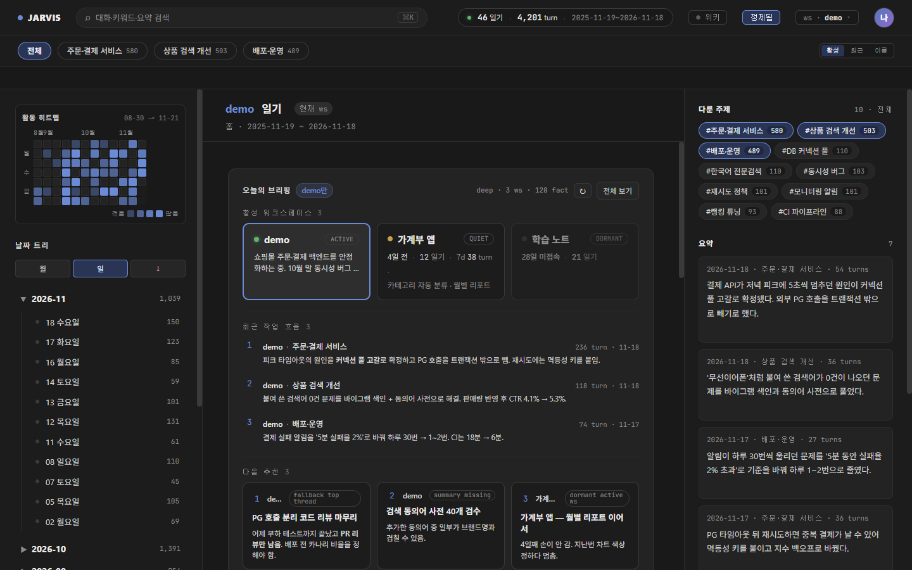
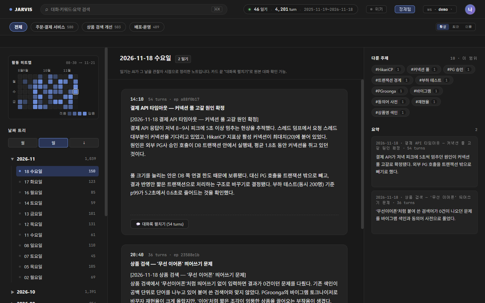
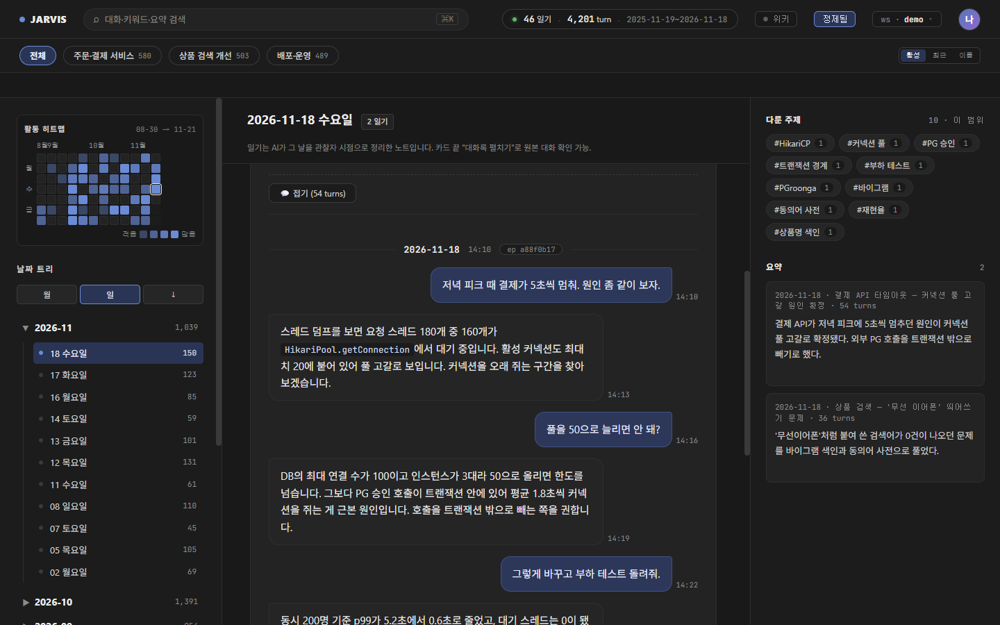
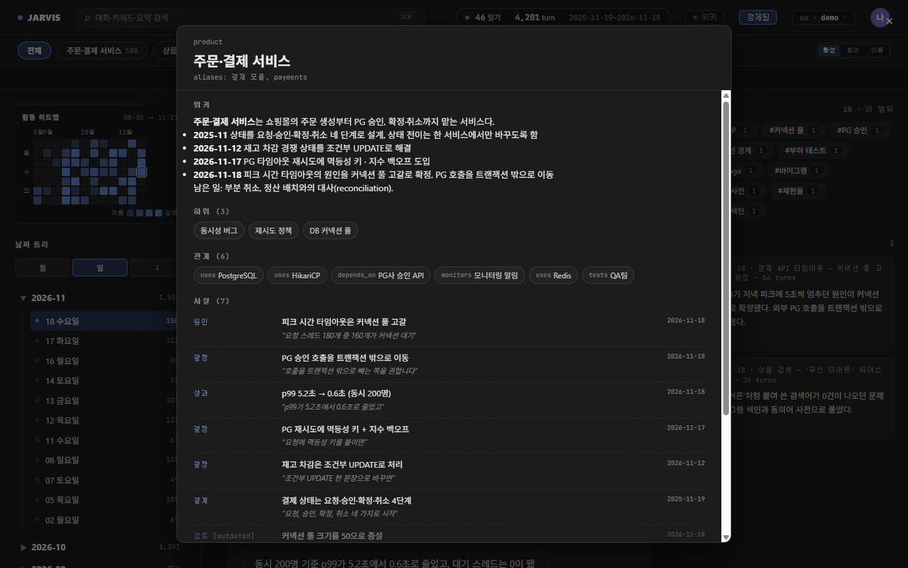
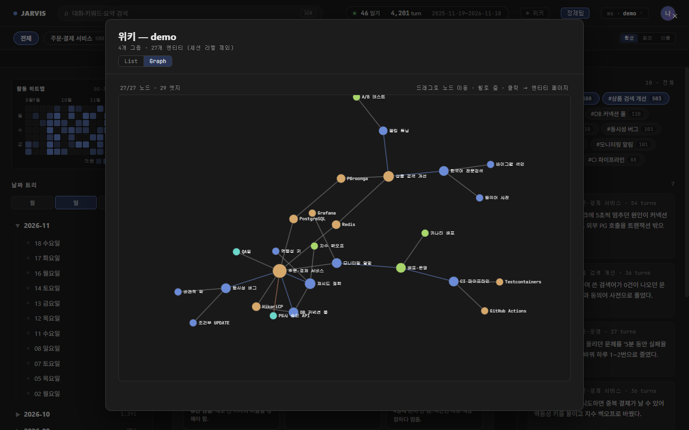
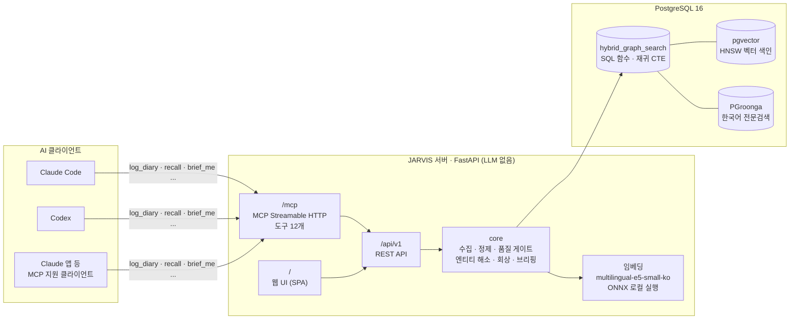
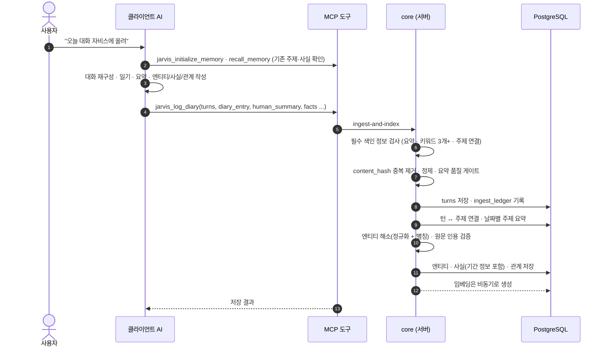
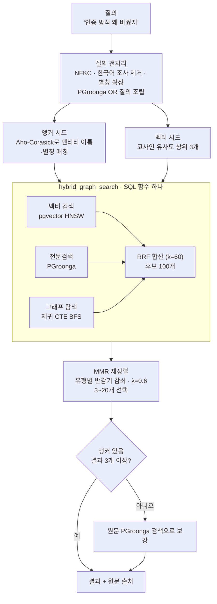
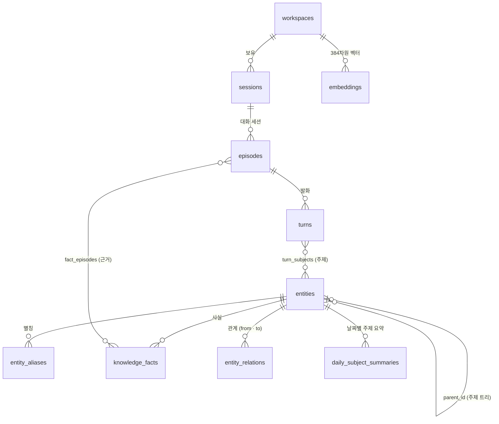

<div align="center">

# 🧠 JARVIS · 자비스

**AI와 나눈 작업 대화를 잊지 않게 해 주는 개인 장기기억 서버**

Claude Code · Codex 같은 AI 도구가 대화를 MCP 도구 한 번으로 "하루치 일기"로 남기고,<br/>
다른 세션·다른 폴더·다른 AI에서도 `recall` 한 번으로 과거의 결정과 그 이유를 되찾습니다.




<sub>웹 UI 홈. 오늘의 브리핑(활성 작업 공간 · 최근 작업 흐름 · 다음 추천), 활동 히트맵, 날짜 트리, 주제별 요약. 화면 속 데이터는 데모용 가짜 데이터입니다.</sub>

</div>

<br/>

```text
나  ▸ 지난주에 인증 방식 왜 바꿨더라?
AI ▸ (jarvis_recall_memory 호출)
     4월 18일 대화: 프록시 뒤에서 쿠키가 안 넘어가 세션 방식을 버리고 토큰 방식으로 바꿨습니다.
     근거는 "Worker 경유 시 Set-Cookie 유실" 확인 결과이고, 대안이던 서버 세션은 인스턴스 2대부터
     공유 저장소가 필요해 보류했습니다. (출처: 그날 대화 원문 3번째 턴)
```

<sub>예시 대화입니다. 실제 데이터는 이 저장소에 들어 있지 않습니다.</sub>

<br/>

## 목차

1. [왜 만들었나](#-왜-만들었나)
2. [한눈에 보기](#-한눈에-보기)
3. [화면](#-화면)
4. [시스템 구조](#-시스템-구조)
5. [기억을 남기는 흐름](#-기억을-남기는-흐름)
6. [기억을 찾는 흐름: 하이브리드 그래프 검색](#-기억을-찾는-흐름-하이브리드-그래프-검색)
7. [MCP 도구 12개](#-mcp-도구-12개)
8. [데이터 모델](#-데이터-모델)
9. [실험으로 확인한 숫자](#-실험으로-확인한-숫자)
10. [기술 스택](#-기술-스택)
11. [로컬에서 실행하기](#-로컬에서-실행하기)
12. [테스트](#-테스트)
13. [개발 과정](#-개발-과정)
14. [한계와 다음 단계](#-한계와-다음-단계)
15. [이 저장소에 대해](#-이-저장소에-대해)

<br/>

## 🤔 왜 만들었나

AI 코딩 도구와 오래 일하면 같은 문제가 반복됩니다.

- **세션이 바뀌면 맥락이 끊깁니다.** 어제 정한 설계와 그 이유를 오늘 AI는 모릅니다.
- **폴더·도구가 바뀌어도 끊깁니다.** Claude Code에서 한 결정을 Codex나 Claude 앱은 모릅니다.
- **긴 로그를 다시 읽히면 토큰이 많이 들고, 정작 중요한 결정은 묻힙니다.**

자비스는 대화를 원문 그대로 쌓지 않고, AI가 **사건 중심 일기 · 사람용 요약 · 지식 그래프(엔티티 · 사실 · 관계)** 로 정리해 남기게 합니다. 찾을 때는 한국어 전문검색 · 벡터 · 그래프를 함께 써서 "무엇을 정했고, 왜 그랬는지"를 출처와 함께 돌려줍니다.

<br/>

## 🔭 한눈에 보기

| | |
|---|---|
| **무엇** | MCP(Model Context Protocol) 서버 + REST API + 웹 UI. AI 클라이언트가 붙어서 기억을 쓰고 읽습니다. |
| **서버에 LLM이 없음** | 요약 · 분류 · 지식 추출은 **이미 대화 맥락을 가진 클라이언트 AI**가 합니다. 서버는 저장 · 검증 · 검색만 맡아 API 비용이 들지 않고 어떤 AI에도 붙습니다. |
| **한국어 우선 검색** | PGroonga 한국어 전문검색 + 다국어 E5 임베딩 + 엔티티 그래프를 SQL 함수 하나로 합칩니다. |
| **근거 확인** | AI가 남긴 사실마다 원문 인용을 붙이고, 퍼지 매칭으로 실제 원문에 있는지 검증해 신뢰도를 매깁니다. |
| **규모** | Python 45개 파일 · 약 1.36만 줄, 웹 UI 단일 파일 약 3천 줄, ORM 테이블 17개, Alembic 마이그레이션 18개, MCP 도구 12개, REST 메모리 라우트 34개 |

<br/>

## 🖼 화면

<table>
  <tr>
    <td width="50%" valign="top">
      
      <p align="center"><b>날짜별 일기</b><br/><sub>그날 남긴 3인칭 사건 일지 카드. 오른쪽에는 그날 다룬 주제와 요약</sub></p>
    </td>
    <td width="50%" valign="top">
      
      <p align="center"><b>대화 원문</b><br/><sub>"대화록 펼치기"로 보는 발화. 사용자 발화는 원문 그대로 남습니다</sub></p>
    </td>
  </tr>
  <tr>
    <td width="50%" valign="top">
      
      <p align="center"><b>엔티티 위키</b><br/><sub>AI가 쓴 위키 글, 하위 주제, 관계, 근거 인용이 붙은 사실 타임라인</sub></p>
    </td>
    <td width="50%" valign="top">
      
      <p align="center"><b>지식 그래프</b><br/><sub>엔티티와 관계를 d3로 그린 그래프. 노드를 누르면 위키로 이동</sub></p>
    </td>
  </tr>
</table>

<sub>화면은 실제 웹 UI(`src/jarvis/web/index.html`)에 데모용 가짜 데이터를 넣어 찍었습니다. 응답은 자비스의 실제 API 응답 모델로 검증한 형태입니다.</sub>

<br/>

## 🏗 시스템 구조



- 입구는 `jarvis.main:app` 하나입니다. `/health`, `/`(웹 UI), `/api/v1/*`, `/mcp`가 한 프로세스에 붙어 있습니다.
- 임베딩 모델은 Docker 이미지에 미리 넣어 두고 서버 안에서 ONNX로 돌립니다. 외부 임베딩 API를 부르지 않습니다.
- 상주하는 백그라운드 작업이 없습니다. 임베딩만 저장 직후 비동기로 만듭니다.

<br/>

## ✍️ 기억을 남기는 흐름

사용자가 "자비스에 올려"라고 하면 클라이언트 AI가 지금 자기 컨텍스트로 대화를 재구성해 `jarvis_log_diary`를 부릅니다.



**같은 대화를 네 겹의 글로 남깁니다**

| 층 | 누가 읽나 | 내용 |
|---|---|---|
| `turns` | 다음 세션의 AI | 사용자 발화는 **한 글자도 바꾸지 않고**, AI 발화는 판단과 근거가 남게 2\~5문장으로 |
| `summary` | 검색 색인 | 내용 길이에 비례한 개요와 키워드 |
| `diary_entry` | 웹 UI 메인 | 800\~1200자 **3인칭 사건 일지**. "무엇이 결정·발견됐나"를 사건 중심으로 |
| `human_summary` | 사람 | 2\~3줄 요약. 사이드바와 위키 화면에 표시 |

여기에 주제별 · 작업 공간별 **누적 요약**(지금까지 어디까지 왔나)을 함께 갱신합니다. AI는 일기 작성자이면서 **위키 편집자** 역할을 해서, 기존 사실을 강화 · 정정 · 폐기하는 새 사실을 남깁니다.

<br/>

## 🔎 기억을 찾는 흐름: 하이브리드 그래프 검색



- **세 가지 신호를 한 번에**: 단어가 맞는 것(전문검색), 뜻이 비슷한 것(벡터), 연결된 것(그래프)을 따로 찾고 순위만 합칩니다(Reciprocal Rank Fusion). 점수 크기가 다른 신호를 정규화 없이 섞을 수 있습니다.
- **오래된 기억은 천천히 흐리게**: 정보 유형마다 반감기(120 · 90 · 60 · 30일)를 두어 최근 것을 앞에 둡니다.
- **비슷한 결과만 쌓이지 않게**: MMR로 관련성과 다양성의 균형을 잡습니다.
- **실패해도 비지 않게**: 앵커가 없거나 결과가 적으면 원문 전문검색으로, 예외가 나면 `ILIKE` 검색으로 내려갑니다.

<br/>

## 🧰 MCP 도구 12개

| 도구 | 하는 일 |
|---|---|
| `jarvis_log_diary` | 대화를 일기 · 요약 · 지식 그래프로 저장 (핵심 쓰기 도구) |
| `jarvis_recall_memory` | 하이브리드 그래프 검색으로 과거 결정 · 사실 회상 |
| `jarvis_brief_me` | "오늘 뭐 하지?" 작업 공간별 활동 분포 · 최근 작업 Top 3 · 다음 추천 3개 |
| `jarvis_explore_topic` | 한 주제의 엔티티 · 사실 · 관계 지도를 가볍게 (recall 응답의 약 4분의 1 크기) |
| `jarvis_search_passages` | 원문 구절 검색 |
| `jarvis_search_episodes` | 세션(에피소드) 단위 검색 |
| `jarvis_get_episode_excerpt` | 긴 세션에서 필요한 부분만 발췌 |
| `jarvis_follow_relation` | 엔티티 관계를 따라가며 탐색 |
| `jarvis_initialize_memory` | 세션 시작 때 주제 트리와 최근 사실 불러오기 |
| `jarvis_manage_workspace` | 작업 공간 만들기 · 고르기 |
| `jarvis_open_ui` | 웹 UI 주소 열기 |
| `jarvis_store_memory` | 예전 방식의 직접 저장 (호환용) |

도구 설명(docstring)에 "자비스에 올려줘", "브리핑" 같은 **자연어 트리거**와 권장 호출 순서를 적어 두어, 클라이언트 AI가 알아서 맞는 도구를 고르게 했습니다.

<br/>

## 🗂 데이터 모델

핵심 테이블만 그렸습니다(ORM 17개 + 원시 SQL 테이블 `ingest_ledger`).



- **주제도 엔티티입니다.** `parent_id`로 주제 트리를 만들고, 한 발화가 여러 주제에 걸칠 수 있게 `turn_subjects`로 다대다 연결합니다.
- **사실은 시간을 가집니다.** `valid_from · valid_to · superseded_at`으로 "언제부터 언제까지 참이었나"를 남겨, 바뀐 결정도 타임라인으로 남습니다.
- **같은 사실이 다시 나오면 덮어쓰지 않고 근거를 늘립니다.** `fact_episodes`로 그 사실을 뒷받침한 세션을 모두 연결합니다.
- `ingest_ledger`는 "어떤 대화가 올라갔고 무엇이 빠졌나"를 추적합니다. 로컬 대화 파일 폴더와 비교해 "안 올라간 대화 N건"을 보여 줍니다.

<br/>

## 📊 실험으로 확인한 숫자

개발하면서 남긴 실험 기록 기준입니다(원래 데이터와 기록 문서는 개인 대화라 공개하지 않습니다).

| 바꾼 것 | 결과 |
|---|---|
| 지식 추출 단위를 "발화 하나"에서 **"사용자 + AI 발화 쌍"** 으로 | 추출 엔티티 78 → 817개 (**10.5배**), 원문 근거 확인율 95.5% → **100%** |
| 긴 세션에서 **필요한 부분만 발췌**하는 도구 | 응답 19KB → 2.5KB (**−87%**), 115KB → 3KB (**−97%**), 시험 질문 7개 모두 통과 |
| 주제 탐색 전용 **가벼운 응답** (`explore_topic`) | recall 응답 크기의 **22\~27%** (2.5KB 대 10\~12KB) |
| 저장된 사실 **품질 감사** | 사실 1,118개 중 82%가 근거 약함, 중복 415쌍 발견 → 품질 게이트와 인용 검증을 넣은 계기 |
| 재수집으로 생긴 **중복 발화 정리** | 중복 5,793행 삭제 (마이그레이션으로 재현 가능하게) |
| 과거 대화 **일괄 분류** | 세션 2,185개 · 발화 19만여 개를 주제별로 재분류 |

<br/>

## 🛠 기술 스택

| 영역 | 기술 | 쓰는 곳 |
|---|---|---|
| **서버** | Python 3.11+, FastAPI, Uvicorn, Pydantic v2 | REST API, MCP 서버, 웹 UI 제공 |
| **MCP** | `mcp` SDK 1.26+ (Streamable HTTP, stateless) | AI 클라이언트 연결 |
| **DB** | PostgreSQL 16, SQLAlchemy 2 (async) + asyncpg, Alembic | 저장소, 마이그레이션 18개 |
| **벡터** | pgvector 0.8 (HNSW) | 384차원 임베딩 검색 |
| **전문검색** | PGroonga 3.2.5 (Groonga 14 소스 빌드) | 한국어 전문검색, 엔티티 이름 · 원문 구절 색인 |
| **임베딩** | `dragonkue/multilingual-e5-small-ko`, sentence-transformers + ONNX Runtime | 로컬 임베딩 (query: / passage: 접두사) |
| **그래프** | 재귀 CTE, python-igraph, leidenalg | 그래프 탐색, 커뮤니티 묶기 |
| **매칭** | ahocorasick-rs, rapidfuzz | 엔티티 앵커 찾기, 원문 인용 검증(임계값 75) |
| **웹 UI** | 빌드 없는 단일 HTML, marked, DOMPurify, d3 | 일기 카드, 잔디 히트맵, 엔티티 그래프, 브리핑 카드 |
| **CLI** | typer | `jarvis` 명령 |
| **품질** | pytest, ruff, mypy(strict) | 테스트 · 린트 · 타입 검사 |
| **배포** | Docker Compose (서버 + DB 이미지) | 시작할 때 `alembic upgrade head` 자동 실행 |

<br/>

## 🚀 로컬에서 실행하기

**준비물**: Docker (Compose v2)

**1. 서버와 DB 띄우기**

```bash
docker compose up -d --build
```

- 서버는 `http://localhost:8002`, DB는 `localhost:5440`에 뜹니다.
- 컨테이너가 시작할 때 마이그레이션(`alembic upgrade head`)을 먼저 돌린 뒤 서버를 띄웁니다.
- DB 이미지는 pgvector 이미지 위에 Groonga · PGroonga를 소스에서 빌드하므로 첫 빌드가 몇 분 걸립니다.

**2. 살아 있는지 확인**

```bash
curl http://localhost:8002/health
```

**3. AI 클라이언트에 연결** (Claude Code 예시)

```bash
claude mcp add --transport http jarvis http://localhost:8002/mcp
```

이제 대화 중에 "이 대화 자비스에 올려", "지난번에 왜 그렇게 정했지?", "브리핑해 줘"라고 하면 됩니다. 웹 UI는 `http://localhost:8002/`에서 봅니다.

**선택 설정**

| 변수 | 설명 |
|---|---|
| `CLAUDE_PROJECTS_DIR` | 로컬 Claude Code 대화 폴더(예: `~/.claude/projects/<프로젝트 폴더>`). "안 올라간 대화" 비교에 씁니다. 비우면 `./claude_projects`를 씁니다 |
| `JARVIS_DATABASE_URL` | Docker 없이 실행할 때 DB 주소 (`postgresql+asyncpg://...`) |
| `JARVIS_OAUTH_SECRET_KEY` | OAuth를 켤 때 쓰는 서명 키 (지금은 OAuth가 꺼져 있음) |

**Docker 없이 서버만** (DB는 따로 준비)

```bash
pip install -e ".[dev]"
python -m uvicorn jarvis.main:app --app-dir src --port 8002
```

> [!WARNING]
> 지금은 **인증이 꺼진 로컬 전용 서버**입니다. 외부에 그대로 열지 마세요. 자세한 내용은 [한계](#-한계와-다음-단계)에 있습니다.

<br/>

## 🧪 테스트

```bash
PYTHONPATH=src python -m pytest -q tests
```

- 자동 테스트 26개가 통과합니다.
  - **대화 정규화 13개**: Claude · OpenAI · Gemini · 일반 형식의 대화 기록을 하나의 표준 형식으로 바꾸는지
  - **정제 · 요약 품질 게이트 13개**: 도구 로그 같은 잡음을 걸러 내고, 너무 짧거나 비어 있는 요약을 막는지
- DB · 회상 · MCP 쪽은 실제 DB가 필요해 자동 테스트가 없습니다. 개발 중에는 실제 데이터로 회귀 질의를 돌려 확인했습니다.
- CI는 아직 없습니다.

<br/>

## 🗓 개발 과정

| 시기 (2026) | 단계 | 내용 |
|---|---|---|
| 02-24 | **기획** | 문제 정의와 기획 문서 |
| 03-04 | **첫 골격** | React + Redis + 외부 LLM(Cerebras) · 외부 임베딩 API 구조 → 이후 폐기 |
| 04-01 | **다시 시작** | 리서치를 바탕으로 "클라우드 컨텍스트 서버"로 재설계 |
| 04-14 ~ 19 | **검색 엔진** | PGroonga 하이브리드 검색, 원문 구절(Fragment), 갭 감지, 앵커 회상 + MMR, 회상 도구 4종, 사실 ↔ 세션 연결 |
| 05-12 | **방향 재정의** | "AI 대화의 git + 위키"에서 **"LLM이 쓰는 일기"** 로. 발화 · 주제 · 날짜별 요약, 수집 API, 타임라인, 웹 UI, 일괄 분류 |
| 06-04 | **v1.0.0** | 일기 4중 레이어, 정제기 · 품질 게이트, **서버에서 LLM 제거**, MCP 연결 오류 수정 |
| 06-14 | **v1.0.1** | 캡스톤 최종 정리 |

가장 큰 결정은 **서버에서 LLM을 뺀 것**입니다. 처음에는 서버가 대화를 받아 직접 요약 · 추출했지만, 이미 대화 맥락을 다 가진 클라이언트 AI가 하는 편이 더 정확하고 비용도 들지 않았습니다. 서버는 그 결과를 검증하고(필수 색인 정보, 품질 게이트, 원문 인용 확인) 잘 찾게 만드는 데 집중합니다.

<br/>

## 🧭 한계와 다음 단계

**보안 (지금은 로컬 전용)**
- MCP용 OAuth 2.1(PKCE + 동적 클라이언트 등록)을 구현했지만 연결을 꺼 두었습니다. REST API에도 인증이 붙어 있지 않습니다.
- 비밀번호 해시가 솔트 없는 SHA-256입니다. 인증을 켜기 전에 bcrypt · argon2로 바꿔야 합니다.
- MCP의 DNS 리바인딩 방어가 꺼져 있습니다. 요청 제한(읽기 120회/분, 쓰기 30회/분)은 메모리 기반이라 서버 1대를 전제로 합니다.

**검색 품질**
- 긴 자연어 질의에서는 회상이 약합니다(작은 E5 모델의 한계).
- `explore_topic` 순위는 아직 기초 수준이고, 여러 프로젝트 내용이 섞여 나올 때가 있습니다.

**코드**
- 엔티티 해소는 1단계(정규화 + 별칭)만 쓰고 있습니다. 엔티티 이름 임베딩을 비교하는 2단계는 아직 쓰지 않습니다.
- 모순 감지(NLI) 모듈과 커뮤니티 재계산은 지금 호출하는 곳이 없습니다.
- `jarvis_open_ui` 도구가 웹 UI 주소를 `localhost:8002`로 가정합니다.

**다음 단계**
- 실사용 검증과 데이터 품질 점검
- 대화가 끝날 때 자동으로 올리는 훅(지금은 사용자가 "올려"라고 해야 함)
- 인증을 켜고 원격 배포

<br/>

## 📌 이 저장소에 대해

- **공개용 사본입니다.** 원래 저장소의 커밋 기록과 일부 파일에는 개인 대화에서 나온 내용이 섞여 있어, 최종 코드만 새 기록으로 올렸습니다.
  - 개인 데이터로 돌리던 일회성 정리 · 분류 · 검증 스크립트는 뺐습니다(`scripts/`에는 DB 초기화 SQL만 남김).
  - 원래 DB의 작업 공간 · 엔티티 ID를 쓰던 데이터 수리 마이그레이션 2개는 체인만 남기고 내용을 비우거나 일반화했습니다.
  - 로컬 사용자 경로와 개인 프로젝트 이름이 들어간 예시는 중립적인 예시로 바꿨습니다.
- **만든 방식**: 캡스톤 프로젝트로 진행했고, 기획부터 설계 · 구현 · 실험까지 혼자 했습니다. AI 코딩 도구(Claude Code)를 페어 프로그래머로 적극 썼습니다.
